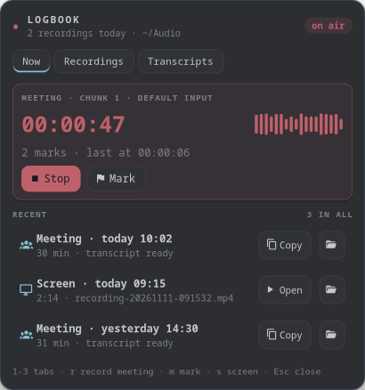

<h1 align="center">Logbook</h1>

<p align="center">
  
</p>

<p align="center">
  <b>One On Air lamp in your bar that is always truthful about your mic.</b><br>
  Meetings, screen captures and dictation behind one icon,<br>
  and every meeting turns into a transcript without you opening a terminal.
</p>

<p align="center">
  <a href="https://github.com/NathanielInman/logbook/actions/workflows/ci.yml"></a>
  <a href="https://github.com/NathanielInman/logbook/releases/latest"></a>
  
  
  <a href="LICENSE"></a>
</p>

Logbook sits next to [Switchyard](https://github.com/NathanielInman/switchyard),
[Roundhouse](https://github.com/NathanielInman/roundhouse) and
[Tannoy](https://github.com/NathanielInman/tannoy) in my bar. Switchyard
dispatches the work, Roundhouse says whether the machine is fit to run it,
Tannoy says what's playing, and Logbook keeps the record of what was said.

## Why

My meeting recorder didn't stop when I told it to. The stop sent `kill --
-$loop_pid` to a process group that didn't exist, then `pkill -P` killed
only the loop's children. The loop woke up and started the next `pw-record`
chunk while the bar icon had already gone dark. Its pid files lived in
`/tmp`, which on this desktop is on disk and survives a reboot, so a crash
mid-meeting left the red icon lit for good. And every meeting ended the same
way: open a terminal, find the dated folder under `~/Audio/meetings`, run the
transcribe, wait, open the file.

Three scripts (`meeting-record.sh`, `screen-record.sh`, `voxtype-status.sh`)
and three bar icons became one daemon and one lamp:

- **Stop really stops.** The daemon owns every recorder as a child in its own
  process group. Stop ends the whole group, and so does the daemon exiting.
  Kill the daemon with `-9` and the kernel still takes its recorders down.
  Live state lives in `$XDG_RUNTIME_DIR`, which a reboot clears.
- **The lamp watches PipeWire.** It also lights when Zoom, Chrome or anything
  else has your mic open, and the drawer says who. Streams that record what
  your speakers play don't count; only a microphone does.
- **Transcripts make themselves.** When a meeting stops, its transcript
  queues as a heavy job in Switchyard, so it waits for a running build and
  never fights a Gradle run for RAM. Without Switchyard it runs under
  `lowprio`. The drawer has a Copy button by the time you've refilled your
  coffee.
- **Marks.** A key drops a **mark** into the meeting, and the transcript gets
  a heading right there: `## Mark 2 · 00:31:12`. You can find the decision
  from minute 31 without reading the whole thing.
- **Do not disturb while recording.** Meetings and screen captures turn
  swaync's do not disturb on (which also hides Tannoy's song title) and give
  it back after, unless it was already on.
- **No polling.** PipeWire's registry, voxtype's state file (inotify) and the
  recorders report their own changes. The clock ticks once a second only
  while something records.

## The lamp

| Lamp | Means |
|---|---|
| dim mic | nothing is listening |
| mic, with the app's name | another app has the mic open |
| red with a running `00:41:12` | Logbook is recording a meeting or the screen |
| red, `listening` | voxtype is taking dictation |
| amber, `saving` | a screen capture's loudness pass |
| amber, `2/3` or `queued` | a transcript is being made, or waits behind a build |

Click it for the drawer, right-click to stop everything, middle-click to
dictate.

## What's in the drawer

**Now:** the live recording with its clock, a level meter, Stop and Mark, or
Record meeting, Record screen and Dictate when you're off air. Below that,
any other app on the mic, the transcript being made (with a progress bar and
what it's queued behind) and the three most recent recordings.
**Recordings:** every meeting and capture with its length, Open, Copy and
Transcribe. **Transcripts:** what's queued, what failed (with Retry) and
every meeting's transcript. <kbd>1</kbd>-<kbd>3</kbd> switch tabs,
<kbd>r</kbd> records a meeting, <kbd>m</kbd> marks, <kbd>s</kbd> records the
screen, <kbd>Esc</kbd> closes.

`logbook status` and `logbook list` print the same in a terminal, and both
take `--json`.

## Install

Logbook is at 0.1 and runs on Linux with Wayland and PipeWire; Hyprland gets
the exact-icon anchoring. Grab a tarball from the
[releases](https://github.com/NathanielInman/logbook/releases) or build it:

```sh
# Arch: the drawer's libraries, PipeWire's headers, and the recorders
sudo pacman -S --needed gtk4 gtk4-layer-shell pipewire clang \
  wf-recorder slurp ffmpeg wl-clipboard

git clone https://github.com/NathanielInman/logbook
cd logbook
cargo build --release
install -Dm755 target/release/logbook target/release/logbook-board -t ~/.local/bin/
logbook setup --systemd   # the Switchyard task and a user service
logbook doctor
```

`pw-record` ships with PipeWire. Transcripts use
[voxtype](https://voxtype.io) (`voxtype transcribe`) unless you point
`transcribe.command` somewhere else; dictation needs voxtype's daemon.
[swaync](https://github.com/ErikReider/SwayNotificationCenter) is optional.

`logbook setup` writes the transcribe task to Switchyard's `tasks.d` and asks
Switchyard to reload. `--systemd` adds `~/.config/systemd/user/logbook.service`
and starts it; without it, `logbook bar` starts the daemon the first time it
runs.

## Put it in your bar

```jsonc
"custom/logbook": {
  "exec": "~/.local/bin/logbook bar",
  "return-type": "json",
  "on-click": "~/.local/bin/logbook toggle",
  "on-click-right": "~/.local/bin/logbook stop",
  "on-click-middle": "~/.local/bin/logbook dictate",
  "tooltip": true
}
```

Use full paths: a waybar started by systemd usually doesn't have
`~/.local/bin` on its `PATH`. The class is the lamp (`off`, `mic`,
`recording`, `dictating`, `processing`, `transcribing`, `offline`):

```css
#custom-logbook { color: @dim; }
#custom-logbook.mic { color: @frost; }
#custom-logbook.recording,
#custom-logbook.dictating { color: @red; }
#custom-logbook.dictating { animation: logbook-pulse 1s ease-in-out infinite alternate; }
#custom-logbook.processing,
#custom-logbook.transcribing { color: @yellow; }
@keyframes logbook-pulse { to { opacity: 0.45; } }
```

## Keys

The CLI is the whole interface, so bind what you like. Mine, in Hyprland:

```lua
hl.bind("code:192", hl.dsp.exec_cmd("~/.local/bin/logbook toggle meeting"))
hl.bind("SHIFT + code:192", hl.dsp.exec_cmd("~/.local/bin/logbook mark"))
hl.bind("SUPER + R", hl.dsp.exec_cmd("~/.local/bin/logbook toggle screen"))
```

```
logbook toggle meeting|screen   start or stop (screen asks slurp for a region)
logbook start | stop [what]     stop with no argument stops everything
logbook mark                    a heading in the transcript at this moment
logbook dictate                 voxtype record toggle
logbook queue <dir>             transcribe an old meeting folder
logbook copy [dir]              the newest transcript to the clipboard
```

## Where things go

Meetings go to `~/Audio/meetings/<YYYY-MM-DD_HH-MM-SS>/` as 15 minute
`chunk-NNN-HHMMSS.wav` files (16 kHz mono), with `marks.json` and
`transcript.md` beside them. That's the layout `meeting-record.sh` used, so
old folders list and transcribe too. Screen captures go to
`~/Videos/recording-YYYYmmdd-HHMMSS.mp4`. Both folders, the chunk length,
the input, the transcriber and the icons are in
`~/.config/logbook/config.toml`; [docs/design.md](docs/design.md#config-keys)
lists every key.

## Development

```sh
cargo test --workspace
# A dev daemon that leaves an installed one alone:
export LOGBOOK_RUNTIME_DIR=/tmp/lb/run LOGBOOK_STATE_DIR=/tmp/lb/state LOGBOOK_CONFIG_DIR=/tmp/lb/cfg
cargo run -p logbook -- daemon
# The drawer as a PNG, no compositor needed:
gtk4-broadwayd :7 & GDK_BACKEND=broadway BROADWAY_DISPLAY=:7 cargo run -p logbook-board -- --render out.png 0
```

[docs/design.md](docs/design.md) is the spec and [AGENTS.md](AGENTS.md) the
notes for working on it.

## License

MIT
